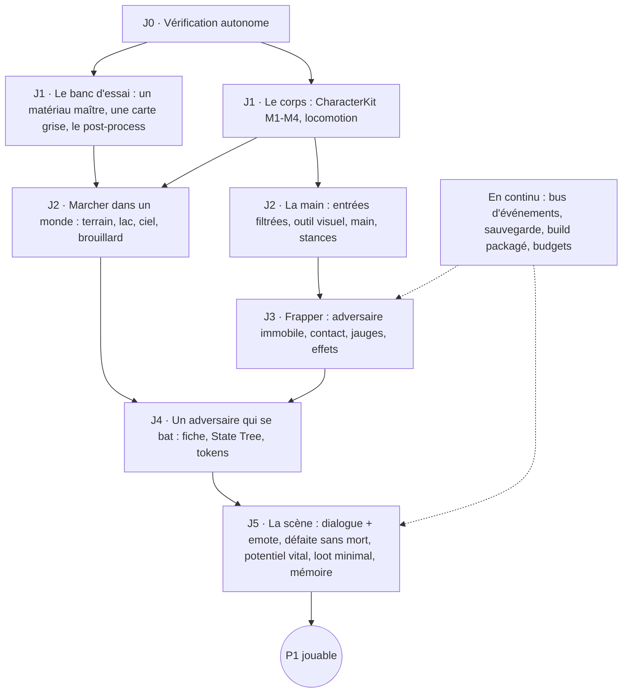

# Feuille de route — jusqu'à la sortie

> Accueil : [[00 - Accueil]] · Catalogue : [[Catalogue_Features]] · Tes actions : [[Checklist_Auteur]]

> Statut : 📝 **proposition de Claude** (2026-10-25), à valider. Écrite après relecture de tout le coffre (plans, guides, catalogue, journal) et un survol du code et du contenu. L'auteur a confié la conduite à Claude « momentanément » (2026-10-25) : Claude propose l'ordre et travaille en lots, l'auteur tranche les décisions et juge ce qui demande un œil humain.

## 1. Le constat

**Beaucoup de briques, peu de jeu.** Le coffre contient une soixantaine de features et une vingtaine de systèmes. Le code compte une douzaine de plugins. Mais :

- **Presque tout est vu par l'auteur** (correction de l'auteur, 2026-10-25 : le journal du coffre était en retard) : Watershed, la corde, le LOA, les lumières maison, le forward, PatchTerrain, GPUTrace (GPU compris), NormalTransfer, le post-process, OKLab / Lighting, LayoutKit, GraphKit. **Pas encore vus : SDFEyes et CharacterKit.**
- **Mais les briques ne tournent pas encore ensemble** dans une même scène de jeu.
- **Il n'existe pas encore de boucle jouable** : aucun personnage du jeu ne marche dans un monde du jeu, ne frappe et ne perd.
- **Des systèmes indispensables à une sortie n'ont jamais été discutés** (§ 3).
- **Le goulot, c'est la vérification** : chaque brique attend un test de l'auteur. D'où le § 5, préalable à tout le reste.

## 2. Ce que « sortir le jeu » veut dire

`À COMPLÉTER` par l'auteur : la taille de la version 1.0. Proposition de paliers, chacun un jeu complet à sa taille :

| Palier | Contenu | Prouve |
|---|---|---|
| **P1 — La scène** | La tranche de [[Plan_VerticalSlice]] : un chef, une prairie, un lac, un camp, se soumettre ou refuser, gagner ou être sauvé | Le combat à la main, la défaite sans mort, un monde qui réagit |
| **P2 — L'acte 1** | Un acte entier façon *Diablo 2* : plusieurs lieux reliés en graphe, des factions, l'économie du potentiel vital fermée, un boss qui peut changer | La boucle complète, la rejouabilité |
| **P3 — Le jeu** | Plusieurs actes, la ponction entre actes, le contenu, la finition | La sortie |

Chaque palier est jouable et pourrait être montré. On ne passe au suivant que si le précédent est amusant.

## 3. L'inventaire complet des systèmes

Légende : ✅ vu marcher · 🔧 codé, pas vu · 📐 conçu · 💭 idée · ⬜ **jamais abordé**.

### Socle technique

| Système | État | Ce qui manque pour P1 |
|---|---|---|
| Infrastructure de tests et de vérification | 🔧 tests unitaires dans 6 plugins | **Tests fonctionnels avec captures**, lanceur en une commande (§ 5) |
| Flux du jeu (GameMode, chargement, pause, menu principal) | ⬜ | Le minimum : lancer, mettre en pause, quitter |
| Sauvegarde et chargement | ⬜ (idée « graine + différences », [[Plan_WorldState]]) | Format commun : chaque système sait écrire et relire son état ; la description du personnage est déjà sérialisable |
| Bus d'événements « X affecte Y » + règle de capacité | 💭 ([[Plan_NPC]]) | La forme, avant le combat : coups, feu, eau, emotes passent tous par là |
| Interface (HUD, menus, options, remappage) | ⬜ (sauf le menu prévu dans [[Plan_PostProcess]]) | HUD minimal, menu d'options (rendu, son, contrôles) |
| Audio (sons, musique, mixage) | ⬜ (le tempo seul : [[Plan_Rhythm]]) | Sons de combat, d'ambiance ; horloge musicale |
| Performance, budgets, scalabilité | ⬜ | Budgets par système (ms), une carte de mesure, options de qualité |
| Packaging, build, distribution | ⬜ | Un build packagé qui tourne hors de l'éditeur, tôt (les assets en lecture seule, le cook, les shaders) |
| Localisation, accessibilité | ⬜ | Rien pour P1 ; textes en `FText` dès le début |

### Personnage et contrôles

| Système | État | Ce qui manque pour P1 |
|---|---|---|
| Mannequin en pièces ([[Plan_Mannequin]]) | 🔧 M1 | M2 profil, M3 ancres, M4 jointures |
| Animation (locomotion, IK des pieds, main) | 💭 (ABP du mannequin, Control Rig de l'auteur) | Locomotion bipède avec pièces ; IK de la main ([[Plan_3C]] § 4) |
| Entrées filtrées + outil visuel ([[Plan_3C]] §§ 1-2) | 📐 | Tout : c'est l'étape 1 de la tranche |
| Main contrôlée, stances, routeur | 📐 | idle, attack, defence, parade |
| Caméra par modes | 📐 | Subjectif seul suffit pour P1 |
| Déplacements (coyote, tampon, lever le pied) | 📐 | Les trois ; le reste plus tard |
| Combat : contact de l'arme, rebond / glissement, dégâts | 📐 | Le cœur de P1 |
| Jauges ([[Plan_Gauges]]) | 💭 (composant de l'auteur) | Vie, équilibre, endurance |
| Visage, yeux, bouche ([[Plan_Face]], [[Plan_Eyes]]) | 🔧 SDFEyes U1 | Pas pour P1 (formes grises) ; le chef peut porter un masque ou un casque |
| Vêtements, armures | 💭 | Pas pour P1 |

### PNJ et société

| Système | État | Ce qui manque pour P1 |
|---|---|---|
| Fiches de PNJ en modules ([[Plan_NPC]]) | 💭 | Perception, tempérament, combat |
| IA de combat (State Tree, tokens d'attaque) | 💭 ([[Guide_StateTree]], [[Plan_FactionAI]]) | Un ennemi lisible, un élite |
| Factions, Eiréné Nexus | 💭 | Deux groupes et une relation qui bouge (la dette) |
| Potentiel vital | 💭 (prototype de l'auteur) | Version minimale cachée |
| Mort imminente | 💭 | Un événement (sauvé par des gardes) |
| Dialogue, emotes, signaux | 💭 / ⬜ (aucun système de dialogue) | L'exigence du chef et l'agenouillement : un dialogue minimal + un emote |
| Synthèse vocale ([[Plan_KlattVoice]]) | 📐 | Pas pour P1 (sous-titres) |
| Loot ([[Plan_Loot]], plugin `UTCWS` de l'auteur) | 💭 | Version minimale `À DÉFINIR` : une arme en pièces qui absorbe, se brise, laisse une pièce |

### Monde

| Système | État | Ce qui manque pour P1 |
|---|---|---|
| Terrain ([[Plan_PatchTerrain]]) | 🔧 étape 1 testée | La prairie de P1 ; navigation (Navigation Invokers) |
| Eau ([[Plan_Water]]) | ✅ lacs | Le lac de P1 ; rendu de surface |
| Végétation, herbe | ⬜ (sauf l'idée des plaques du feu) | Herbe et arbres simples (instanciés) |
| Lieux, camp, bâtiments ([[Plan_KitbashTool]], LayoutKit, LOA) | 🔧 v0 | Le camp en kit |
| Génération d'un acte (graphe de lieux, [[Plan_DreamPlaces]], [[Plan_Graph]]) | 💭 / 🔧 GraphKit | Pas pour P1 (lieu fait à la main) ; cœur de P2 |
| État du monde, persistance ([[Plan_WorldState]]) | 💭 | « Le monde se souvient » du chef : un drapeau sauvegardé |
| Feu, foudre, rythme | 💭 | Pas pour P1 (P2) |
| Corde ([[Guide_Rope]]) | ✅ | Pas pour P1 |

### Rendu

| Système | État | Ce qui manque pour P1 |
|---|---|---|
| Forward, lumières maison, OKLab | ✅ / 🔧 | **Un matériau maître unique** qui assemble tout (éclairage, ombres GDF, transfert de normales), appliqué à toute la scène de P1 |
| Post-process maison | 🔧 | Le monter (guide existant) |
| Culling des lumières | 📐 | Pas pour P1 (peu de lumières) |
| Ciel, soleil, heure, brouillard | ⬜ / 💭 (« changer le ciel », « notre fog ») | Un ciel et un brouillard maison simples |
| Nuages ([[Plan_Clouds]]) | 💭 | P2 |
| Ambiance (surfels), focus | 💭 | P2 |
| Effets (Niagara : impacts, sang, poussière, fumée) | ⬜ | Impacts de combat, éclats du bris |

### Outils

| Outil | État | Pour |
|---|---|---|
| Confort d'éditeur ([[Plan_EditorUX]]) | 📐 | Tous les plugins ; en attente de validation |
| Outil de filtrage d'entrée | 📐 | P1, indispensable |
| Outil de personnage (M5), outils de forme (M7) | 📐 | P2 |
| Tableau de bord du potentiel vital, simulation « et si » | 💭 | P2 |

## 4. L'ordre : le chemin critique

| Jalon | Lots (dans l'ordre) | Ce que Claude vérifie seul | Ce qui attend l'œil de l'auteur |
|---|---|---|---|
| **J0 — Vérification autonome** | Plugin de tests fonctionnels commun ; lanceur `Tools/RunTests.ps1` ; captures hors écran comparées à des références ; rapport | Tout | Rien |
| **J1 — Banc d'essai** | Matériau maître (lumières, soleil, ombres GDF, normales) monté par script ; carte grise de référence ; post-process | Compilation, captures (pas de pixel noir, pas d'erreur), mesures ms | Le rendu : juste ou pas |
| **J1 — Le corps** | CharacterKit M2 (profil), M3 (ancres + yeux), M4 (jointures) ; locomotion | Pièces sur leurs os image par image, description sauvegardée = relue, captures du mannequin en marche | Les jointures, les yeux |
| **J2 — Le monde** | Terrain + lac + herbe + ciel / brouillard simples dans la carte de P1 | Génération déterministe, performance | L'ambiance |
| **J2 — La main** | Sondes + outil visuel ; modifiers ; routeur ; main ; stances | Les filtres (tests sur des entrées synthétiques), l'outil (captures) | **Le ressenti** : seul l'auteur peut le juger |
| **J3 — Frapper** | Bus d'événements ; contact de l'arme ; jauges ; impacts | Rebond / glissement sur des cas types, conservation des jauges | Le ressenti du coup |
| **J4 — L'adversaire** | Fiche de PNJ ; State Tree ; tokens ; phases lisibles | Combats simulés IA contre IA (durées, issue) | La lisibilité |
| **J5 — La scène** | Dialogue minimal + emote ; mort imminente ; potentiel vital ; loot minimal ; mémoire | Somme nulle vérifiée par tests ; sauvegarde / chargement | Est-ce amusant ? |

**En continu, dès J1** : un **build packagé** à chaque jalon (pour découvrir tôt ce qui casse hors de l'éditeur), les **budgets** de temps par système, et le **journal**.

**Ce qui est volontairement repoussé après P1** : visage et bouche, vêtements, voix, factions complètes, feu, rythme, nuages, surfels, culling, génération d'un acte. Ce sont des chantiers de P2. SDFEyes et CharacterKit continuent en arrière-plan quand un lot s'y prête.

## 5. La vérification autonome (J0, préalable)

**État (2026-10-25) : ✔ en place.** `Tools/RunTests.ps1 <Filtre>` ouvre l'éditeur **avec sa fenêtre** (décision de l'auteur), lance les tests, enregistre le rapport (`Saved/Automation/Reports/index.json`) et se ferme ; il refuse de démarrer si un éditeur est déjà ouvert. Premier usage : `CharacterKit` (3 tests fonctionnels dans un monde créé en mémoire, captures PNG par Scene Capture). Pièges notés : un monde créé en mémoire ne fait pas jouer l'animation au tick, les tests posent le mannequin explicitement ; le mannequin regarde vers +Y.

L'auteur le fait déjà au travail : des tests automatiques Unreal, avec des prévisualisations.

- **Tests unitaires** (déjà en place dans 6 plugins) : logique pure, sans monde.
- **Tests fonctionnels** : un monde de test créé en mémoire (pas de `.umap`), des acteurs posés par le code, quelques secondes simulées, des vérifications. Exemple : le mannequin marche 3 s ; chaque pièce reste à moins de 1 mm de son os.
- **Captures** : le test rend une image hors écran (`-RenderOffscreen`), l'enregistre dans `Saved/Automation/`, la compare à une référence ; Claude regarde les images.
- **Lanceur** : une commande lance l'éditeur sans fenêtre (`UnrealEditor-Cmd.exe … -ExecCmds="Automation RunTests …"`), récupère le rapport et les images.
- **Hors moteur** : shaders compilés par DXC / FXC, aperçus WebGL pour la mise au point visuelle, schémas en SVG ou Mermaid dans le coffre.
- **Limites honnêtes** : la sensation des contrôles, le goût d'un visage, l'ambiance d'une scène ne se testent pas automatiquement. Ce sont les seuls points où l'auteur est indispensable ; ils sont regroupés dans [[Checklist_Auteur]].

## 6. Les conventions transverses (pour que tout tienne ensemble)

1. **Description / préréglage** (décidé pour le personnage, 2026-10-21) : tout ce que le jeu modifie est une **structure de données** sérialisable ; les assets ne sont que des points de départ. Vaut pour les objets du loot, les PNJ, les réglages, l'état du monde. C'est ce qui rend la sauvegarde simple.
2. **Graine + différences** ([[Plan_WorldState]]) : tout ce qui est généré l'est à partir d'une graine ; on ne sauvegarde que ce qui a changé.
3. **Somme nulle vérifiée par tests** (eau, potentiel vital, énergie du bris) : un test par flux.
4. **Un bus d'événements « X affecte Y »**, avec la règle de capacité : le joueur n'est jamais un cas spécial.
5. **Logique séparée du visuel**, chaque système testable sans rendu.
6. **Debug minimal par plugin** ([[Plan_EditorUX]]) : catégorie en tête, état en clair, variable console.
7. **Pas de « Dwam » dans les systèmes génériques** ; le reste dans le module de jeu.

## 7. Comment on travaille (proposition)

- **Des lots** : plan court (dans le plan du système), code, tests, captures, documentation, compte rendu. Un lot fait quelques heures à une journée de travail de Claude.
- **Le compte rendu** distingue toujours : ✔ vérifié par Claude · ⚙ compilé seulement · 👁 attend l'œil de l'auteur.
- **L'auteur intervient aux jalons** (décisions, recette), pas à chaque lot. Les recettes sont regroupées dans [[Checklist_Auteur]].
- **Les décisions de goût et de design restent à l'auteur** ; Claude propose, avec des schémas et des aperçus.
