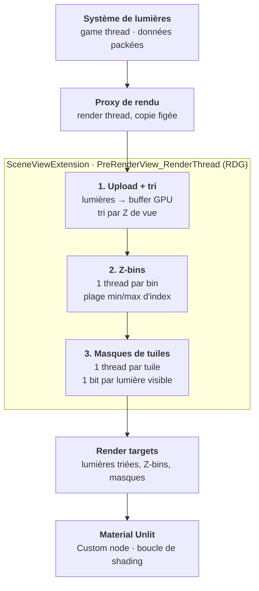

# Plan — Culling des lumières : clustered lighting par Z-binning

> Accueil : [[00 - Accueil]] · Lié à : [[Plan_Lights]] · [[Guide_OKLab]] · [[Plan_PostProcess]] · [[Plan_Water]]

> Statut : **document de l'auteur** (« Clustered lighting par Z-binning », 2026-10-11), versé dans le coffre le 2026-10-11. Pas codé. Cible : UE **5.8** (le titre d'origine disait « 5.7 » par habitude, corrigé à la demande de l'auteur). Vérifié dans le source 5.8 : `PreRenderView_RenderThread(FRDGBuilder&, FSceneView&)`, `RegisterExternalTexture` et `bCanCreateUAV` existent tels que cités ; dans `FSceneViewExtensionBase`, `IsActiveThisFrame` est `final` : le filtrage des vues se surcharge dans `IsActiveThisFrame_Internal`. Le reste n'est pas revérifié. Le schéma « flux de données » est retranscrit en Mermaid d'après la capture de l'auteur.

> Budget (auteur, 2026-10-11) : **32 à 64 lumières directes**, « avec de la marge ». S'y ajouteraient les émetteurs d'ambiance de [[Plan_AmbientLights]] (idée) : dimensionnement à revoir si elle se concrétise.

## Contexte et objectifs

Le culling des lumières est construit sur GPU, dans la frame, par un plugin UE 5.8, sans aucune modification du moteur. Le shading reste entièrement dans les materials.

**Contraintes de départ**

- Shading custom (Perceptual Based Rendering, OKLab) construit à partir du shading model Unlit. Le tonemapping moteur est remplacé.
- La grille de lumières native d'UE (`LightGridInjection.cpp`) n'est pas exploitable : elle ne connaît pas les lumières du projet et n'est pas exposée aux materials.
- Les lumières ont leur propre système. Elles arrivent aujourd'hui au shader via une texture 1D, 2 pixels par lumière, avec un packing binaire.
- Ombres gérées par un système maison. Pas de Nanite, pas de TSR/TAA.

**Problème** : sans culling, chaque pixel boucle sur toutes les lumières. Le coût croît linéairement avec leur nombre.

**Objectifs**

- Chaque pixel ne traite que les lumières qui le touchent.
- Données construites avec la caméra exacte de la frame rendue : pas de décalage d'une frame.
- Coût CPU quasi nul ; supporte plusieurs centaines à quelques milliers de lumières.
- Format de lumière existant conservé autant que possible.

## Principe du Z-binning

Le Z-binning remplace la grille 3D de froxels par deux structures indépendantes : une plage d'index par tranche de profondeur, et un bitmask de lumières par tuile écran. Référence : Drobot, *Improved Culling for Tiled and Clustered Rendering*, SIGGRAPH 2017 (Activision).

**Prérequis** : les lumières sont triées par profondeur de vue. Une tranche de profondeur touche alors une plage contiguë d'index.

**Z-bins (1D)** : la profondeur de vue est découpée en N bins. Chaque bin stocke `minIndex, maxIndex` des lumières dont l'étendue en Z le chevauche.

**Masques de tuiles (2D)** : l'écran est découpé en tuiles. Chaque tuile stocke un bitmask, avec 1 bit par lumière dont la projection couvre la tuile.

**Au shading** : le pixel lit la plage de son bin et le masque de sa tuile, ne garde que les bits de la plage et itère sur les bits restants.

| Critère | Grille 3D classique | Z-binning |
| --- | --- | --- |
| Structure | listes par froxel (X × Y × Z) | Z-bins 1D + masques 2D |
| Mémoire | listes d'index de taille variable | fixe : 1 plage par bin, 1 masque par tuile |
| Construction | atomics ou prefix sum | écritures indépendantes, sans synchronisation |
| Précision en Z | limitée par le nombre de tranches | bins fins à coût quasi nul |
| Boucle de shading | liste d'index indirecte | itération directe sur les bits |

## Architecture du plugin

Le plugin s'insère au début du rendu de chaque vue via une `FSceneViewExtensionBase`. Il construit les données de culling en RDG et les écrit dans des render targets que les materials lisent pendant la base pass.

**Tout le culling se construit sur GPU, avec la caméra de la frame** *(schéma de l'auteur, retranscrit en Mermaid d'après sa capture du 2026-10-11)*



> Écart à trancher (relevé par Claude, 2026-10-11) : le schéma dit « 1 thread par bin » et « 1 thread par tuile » ; la section *Passes de calcul* dit « 1 thread par lumière triée » pour ces deux passes. Ce sont deux façons de construire (gather contre scatter) ; le texte détaillé est celui du scatter avec atomics.

Le game thread ne fait que collecter les lumières. Tout ce qui dépend de la caméra est calculé sur GPU, dans la frame rendue.

**Modules**

- **Runtime** (`LoadingPhase: PostConfigInit`) : nécessaire pour compiler des global shaders depuis un plugin. `StartupModule` appelle `AddShaderSourceDirectoryMapping` vers le dossier `Shaders/` du plugin.
- **Editor** (optionnel) : vues de debug et réglages.

**Composants**

- **`ULightCullingSubsystem`** (`UWorldSubsystem`) : possède l'extension (`FSceneViewExtensions::NewExtension`), les render targets et les paramètres globaux (taille des tuiles, nombre de bins).
- **Collecte (game thread)** : chaque frame, le système de lumières produit un tableau compact de données packées. Il est transmis au render thread par `ENQUEUE_RENDER_COMMAND`, en copie, sans partage d'état.
- **`FLightCullingViewExtension`** : surcharge `PreRenderView_RenderThread(FRDGBuilder&, FSceneView&)` et enchaîne les passes. Les render targets sont enregistrés dans RDG avec `RegisterExternalTexture`.
- **Filtrage des vues** : `IsActiveThisFrame` ignore les scene captures, les reflection captures et les vues secondaires. Sinon, une capture écrase les données de la vue principale.

**Sorties lues par les materials** : des `UTextureRenderTarget2D` persistants, référencés comme paramètres texture. Les paramètres qui dépendent de la caméra (near, far, échelle des bins, nombre de tuiles) sont écrits par le GPU dans une ligne de ces textures, jamais via une Material Parameter Collection : celle-ci est mise à jour depuis le game thread et réintroduirait le décalage d'une frame.

## Données GPU

Les passes de calcul lisent des buffers RDG transitoires. Les materials ne lisent que des render targets persistants, parce qu'un Custom node ne peut pas lier de structured buffer.

| Ressource | Type | Format | Taille | Contenu |
| --- | --- | --- | --- | --- |
| LightsIn | buffer RDG (upload) | uint4 | 2 × N lumières | données packées telles que produites par le système de lumières |
| SortKeys | buffer RDG | uint2 | N | (profondeur de vue en bits, index d'origine) |
| LightsSorted | render target | RGBA32F, bits réinterprétés | 2 × N pixels (repli sur plusieurs lignes au-delà de 8192 lumières) | même packing que la texture 1D actuelle, dans l'ordre trié |
| ZBins | render target | RG32F, bits réinterprétés | NumBins × 1 | minIndex, maxIndex ; bin vide = (0xFFFFFFFF, 0) |
| TileMasks | render target | RGBA32F, bits réinterprétés | TilesX × (TilesY × couches) | 128 bits de lumières par pixel ; une couche par tranche de 128 lumières |
| CullingParams | render target | RGBA32F | 4 × 1 | near, far, échelle et biais des bins, taille et nombre de tuiles, nombre de lumières et de couches |

**Règles**

- Render targets créés avec `bCanCreateUAV = true`, sans mips, en filtrage `Nearest`, non sRGB.
- Les entiers sont stockés par réinterprétation de bits (`asfloat` à l'écriture, `asuint` à la lecture), sans opération arithmétique entre les deux. C'est la même technique que le packing actuel.
- **Allocation à la taille maximale** : la grille de tuiles est dimensionnée pour la plus grande résolution visée, par exemple 4K en tuiles de 16 px (240 × 135). La taille réelle utilisée est lue dans CullingParams. On évite ainsi toute réallocation au redimensionnement.
- **Ordre de grandeur** : en 1080p avec des tuiles de 16 px et 1024 lumières, on obtient 120 × 68 tuiles × 128 octets, soit environ 1 Mo pour TileMasks.

## Passes de calcul

Six passes RDG s'enchaînent dans `PreRenderView_RenderThread`. Les écritures concurrentes passent par des buffers `uint` avec atomics, puis une copie finale alimente les render targets.

1. **Paramètres** (1 thread). Calcule near, far et la distribution des bins, puis écrit CullingParams.
   - Bins exponentiels : `bin = floor(log(z / near) * scale)` avec `scale = NumBins / log(far / near)`.
   - Avec un reversed-Z à far infini, `far` est la distance maximale d'influence des lumières visibles, ou une distance fixe.
2. **Bornes et clés** (1 thread par lumière). Transforme la lumière en espace vue à partir des positions relatives à la caméra (translated world, compatible LWC).
   - Calcule `[zMin, zMax]` en vue et le rectangle écran de la sphère projetée, converti en tuiles (Mara & McGuire 2013, *2D Polyhedral Bounds of a Clipped, Perspective-Projected 3D Sphere*).
   - Une sphère qui coupe le near plane couvre tout l'écran.
   - Les lumières hors frustum sont rejetées ici.
   - Écrit la clé `(asuint(zMin), index)` et les bornes dans un buffer intermédiaire.
3. **Tri** des clés par `zMin`. Jusqu'à 1024 lumières : bitonic sort dans un seul groupe, en mémoire partagée. Au-delà : bitonic multi-passes ou radix sort GPU.
   - L'ordre n'affecte que la compacité des plages, pas la justesse : un tri approximatif reste correct. Un premier jalon peut donc trier sur CPU.
   - Une passe de gather écrit ensuite LightsSorted et les bornes triées.
4. **Z-bins** (1 thread par lumière triée). Chaque lumière parcourt les bins couverts par `[zMin, zMax]` et y applique `InterlockedMin` et `InterlockedMax` sur son index trié. Buffer initialisé à `(0xFFFFFFFF, 0)` par `AddClearUAVPass`. Le coût est proportionnel au nombre de bins couverts, pas à bins × lumières.
5. **Masques de tuiles** (1 thread par lumière triée). Chaque lumière parcourt les tuiles de son rectangle écran.
   - Test fin par tuile : sphère contre frustum de tuile pour les point lights, cône contre sphère englobante de la tuile pour les spots (voir *Culling par type de lumière*).
   - Si le test passe : `InterlockedOr` du bit de la lumière dans le mot `(tuile, index / 32)`.
   - Coût proportionnel aux tuiles couvertes.
6. **Copie** vers les render targets ZBins et TileMasks (réinterprétation de bits, 1 thread par pixel).

**Limite à connaître** : à ce point d'accroche, la depth prepass n'a pas encore tourné. Les tuiles n'ont donc pas de bornes de profondeur min/max, et le culling en Z repose entièrement sur les Z-bins. De plus, la plage d'un bin est un intervalle min–max d'index triés : elle peut inclure des lumières qui ne touchent pas ce bin. La boucle de shading garde donc un test de portée par lumière avant tout calcul coûteux.

## Lecture côté material

Le Custom node du material Unlit ne contient qu'un appel. La boucle et le shading vivent dans un fichier `.ush` du plugin, inclus via le champ *Include File Paths* du Custom node, grâce au mapping `/Plugin/<NomDuPlugin>/` déclaré au démarrage du module.

**Entrées du Custom node** : les quatre textures (Texture Object), `PixelDepth` (profondeur de vue linéaire), la position monde relative à la caméra, la normale, le vecteur de vue et les entrées matériau du shading.

```hlsl
// LightCulling.ush — boucle de shading Z-binnée
float3 ShadeClusteredLights(Texture2D LightsTex, Texture2D ZBinsTex, Texture2D MasksTex,
                            Texture2D ParamsTex, float ViewZ, float2 SvPos, /* entrées de shading */ ...)
{
    float4 p0 = ParamsTex.Load(int3(0, 0, 0));   // near, far, binScale, numBins
    float4 p1 = ParamsTex.Load(int3(1, 0, 0));   // tileSize, tilesX, tilesY, numLayers
    float  zNear    = p0.x;
    float  binScale = p0.z;
    uint   numBins  = asuint(p0.w);
    uint   tileSize = asuint(p1.x);
    uint   tilesY   = asuint(p1.z);

    uint  bin   = (uint)clamp(floor(log(max(ViewZ, zNear) / zNear) * binScale), 0, numBins - 1);
    uint2 range = asuint(ZBinsTex.Load(int3(bin, 0, 0)).xy);   // (minIndex, maxIndex)
    float3 result = 0;
    if (range.x > range.y) return result;                     // bin vide

    uint2 tile = uint2(SvPos - View.ViewRectMin.xy) / tileSize;

    [loop] for (uint w = range.x / 32; w <= range.y / 32; ++w)
    {
        uint4 m4 = asuint(MasksTex.Load(int3(tile.x, tile.y + (w / 4) * tilesY, 0)));
        uint  m  = m4[w & 3];
        uint  lo = max(range.x, w * 32) - w * 32;              // bits hors plage masqués
        uint  hi = min(range.y, w * 32 + 31) - w * 32;
        m &= (0xFFFFFFFFu << lo) & (0xFFFFFFFFu >> (31 - hi));

        [loop] while (m != 0)
        {
            uint i = w * 32 + firstbitlow(m);
            m &= m - 1;
            result += ShadeLight(LightsTex, i, /* entrées de shading */ ...);   // test de portée en tête
        }
    }
    return result;   // radiance linéaire ; conversion OKLab et tonemapping après accumulation
}
```

**Points d'attention**

- `[loop]` sur les deux boucles : sans lui, le compilateur de materials peut tenter un déroulage.
- `View.ViewRectMin` corrige l'offset de la vue (split-screen, viewport partiel).
- `ShadeLight` commence par le test de portée, avant de décoder le reste des données de la lumière.
- **Scalarisation (optionnelle)** : union des masques sur le wave avec `WaveActiveBitOr`, itération commune, puis chaque pixel vérifie son propre bit. Les données d'une lumière sont alors chargées une fois par wave. À placer derrière les macros de capacité wave du moteur et à valider sur chaque plateforme cible : la disponibilité des wave ops dans un shader de material n'est pas garantie.
- **Translucence et volumétrique** : la même fonction et les mêmes textures, pour un éclairage cohérent entre opaque et translucide.

## Culling par type de lumière et portée finie

Le culling n'est correct que si la portée de chaque lumière est réellement finie. Avec une atténuation en inverse carré pure, l'éclairage ne s'annule jamais : couper la lumière à sa portée crée une frontière visible.

**Atténuation fenêtrée** (celle d'UE), avec d la distance et r la portée :

```latex
E(d) = \frac{\left(\mathrm{saturate}\left(1 - (d/r)^4\right)\right)^2}{d^2 + 1}
```

Le `+ 1` du dénominateur, en unités de distance au carré, évite la singularité à d = 0 ; il est à ajuster à l'échelle du projet.

| Type | Bornes pour Z-bins et rectangle écran | Test fin par tuile |
| --- | --- | --- |
| Point | sphère (centre, r) | sphère contre les 4 plans latéraux du frustum de tuile |
| Spot | sphère englobante du cône (ci-dessous) | cône contre sphère englobante de la tuile |
| Rect / area | sphère (centre, r) | sphère, puis rejet des tuiles entièrement derrière le plan émetteur |
| Directionnelle | hors système | traitée à part, une seule fois par pixel |

**Sphère englobante d'un spot** (portée r, demi-angle θ) :

- si θ ≤ 45° : rayon = r / (2 cos θ), centre = apex + dir × rayon ;
- sinon : rayon = r × sin θ, centre = apex + dir × r × cos θ.

**Test cône contre sphère de tuile** (Wronski, *Cull that cone*, 2016). C, R = centre et rayon de la sphère de la tuile :

```hlsl
bool ConeIntersectsSphere(float3 apex, float3 dir, float range, float sinA, float cosA,
                          float3 C, float R)
{
    float3 V        = C - apex;
    float  lenSq    = dot(V, V);
    float  v1Len    = dot(V, dir);
    float  distClosest = cosA * sqrt(max(lenSq - v1Len * v1Len, 0)) - v1Len * sinA;
    return !(distClosest > R || v1Len > R + range || v1Len < -R);
}
```

Sans ce test, un spot long et étroit active toutes les tuiles de sa sphère englobante.

**Compléments**

- **Fondu de distance** : l'intensité des petites lumières tend vers 0 selon leur taille à l'écran, avant leur sortie des listes. Sinon, elles disparaissent d'un coup.
- **Canaux de lumière** : un masque 32 bits par lumière dans les données packées, combiné en AND avec celui du material. Le coût est quasi nul.
- **Ombres** : l'index d'atlas ou de shadow map du système maison est stocké dans les données de la lumière, avec un flag d'early-out pour les lumières sans ombre.

## Pièges, debug et validation

Le critère de validation principal est une différence d'image nulle entre le rendu culled et une boucle brute-force sur toutes les lumières. Avec une portée fenêtrée, tout écart signale un bug de culling.

**Pièges**

- **Plusieurs vues dans une même view family** (split-screen) : `PreRenderView_RenderThread` peut s'exécuter pour toutes les vues avant leurs base passes. Avec un seul jeu de render targets, la dernière vue écrase les autres. Il faut un jeu par vue, indexé par l'index de vue. Les viewports éditeur séparés sont des view families distinctes, rendues l'une après l'autre.
- **Scene captures et reflection captures** : à exclure via `IsActiveThisFrame`, sinon elles écrasent les données de la vue principale.
- **Précision** : toujours des positions relatives à la caméra. Des positions monde absolues en float se dégradent loin de l'origine (LWC).
- **Reversed-Z à far infini** : le far des bins doit être une distance choisie, pas le far plane de la projection.
- **Dépassement de capacité** : au-delà du nombre maximal de lumières ou de couches de masques, il faut une politique explicite (priorité par taille à l'écran, plafond) et un avertissement en log, jamais une troncature silencieuse.
- **Réinterprétation de bits** : valider l'aller-retour `asfloat` / `asuint` avec un motif de test (tous les bits, NaN, dénormaux) sur chaque plateforme cible.
- **Lumières très proches de la caméra** : elles couvrent tout l'écran et beaucoup de bins. Leur coût est réel mais attendu ; c'est à surveiller dans la heatmap.
- **Itération sur les shaders** : une modification du `.ush` inclus par le Custom node nécessite une recompilation des shaders modifiés (`recompileshaders changed`).

**Outils de debug**

- **CVar de bypass** : bascule entre le culling et la boucle brute-force, pour la comparaison d'image.
- **Heatmap** : nombre de lumières évaluées par pixel, via un switch de debug dans la fonction de shading.
- **Visualisation** : grille de tuiles et couleur par Z-bin en overlay.
- **Profilage** : chaque passe sous `RDG_EVENT_SCOPE` et `RDG_GPU_STAT_SCOPE`, lisible dans `ProfileGPU` et `stat GPU`.

## Plan de mise en œuvre

La mise en œuvre se fait en sept étapes. Chacune reste comparable à la référence brute-force construite à l'étape 2, ce qui permet de détecter toute régression immédiatement.

| Étape | Livrable | Validation |
| --- | --- | --- |
| 1. Squelette | module Runtime en PostConfigInit, mapping des shaders, subsystem, extension enregistrée, passe RDG vide | la passe apparaît dans `ProfileGPU` ; aucune vue secondaire ne la déclenche |
| 2. Référence brute-force | upload GPU des lumières, LightsSorted et CullingParams écrits par le GPU, boucle sur toutes les lumières dans le `.ush` | image identique au système actuel en texture 1D |
| 3. Z-bins seuls | tri sur CPU, passes Z-bins + copie, masques de tuiles forcés à « tout actif » | différence nulle avec l'étape 2 ; heatmap en baisse |
| 4. Masques de tuiles | point lights, puis spots (cône), puis rect lights | différence nulle avec l'étape 2, CVar de bypass active |
| 5. Tri GPU | bitonic sort (puis radix au-delà de quelques milliers), suppression du tri CPU | différence nulle ; temps CPU de la collecte seule |
| 6. Outils | heatmap, overlay tuiles et bins, stats GPU, politique de dépassement | lisibles en éditeur et en build de développement |
| 7. Optimisation | taille de tuile (8, 16 ou 32 px), nombre de bins, scalarisation, réutilisation en translucence et volumétrique | mesures avant et après dans `ProfileGPU` sur une scène de test fixe |

Le split-screen (un jeu de render targets par vue) n'est à traiter que si le projet le requiert. Il s'insère après l'étape 4 sans changer le reste.
