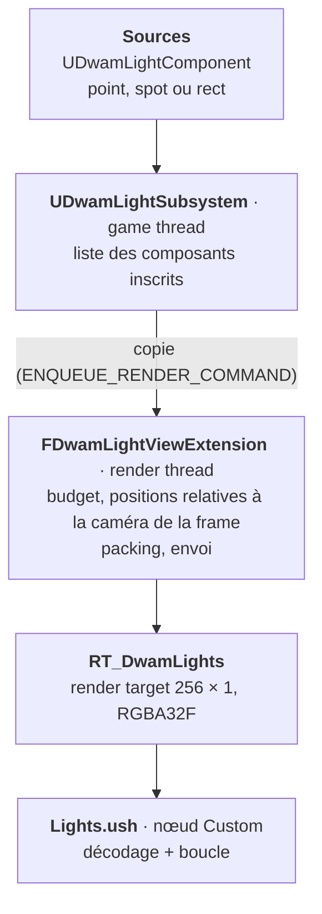

# Plan — Lumières : collecte, packing et envoi aux matériaux

> Accueil : [[00 - Accueil]] · Lié à : [[Guide_Lights]] · [[Plan_LightCulling]] · [[Guide_OKLab]] · [[Plan_PostProcess]] · [[Plan_NormalTransfer]]

> Statut : **validé par l'auteur le 2026-10-11, avec un changement** (pas de lumières « fantômes » : un composant maison). **Étapes 1 à 3 codées et compilées le 2026-10-11** ; 3 tests automatiques du packing réussis ; `Lights.ush` validé par compilation hors moteur (DXC et FXC). **Rien n'est encore vu dans l'éditeur** : le chemin de rendu attend le render target à créer, voir [[Guide_Lights]]. Historique : proposition de Claude du même jour. Les lumières d'ambiance ([[Plan_AmbientLights]]) sont hors sujet (« on s'en fiche totalement », auteur).

## Ce que couvre cette brique

La brique en amont du culling : **d'où viennent les lumières, sous quelle forme, et comment elles arrivent au shader.**

- Dedans : les sources (ce qu'on pose dans le niveau), la collecte, le packing, l'envoi au GPU, la lecture dans le matériau, une boucle brute-force de référence.
- Dehors : le culling ([[Plan_LightCulling]], étapes 3 à 7), les ombres par lumière (un drapeau est réservé, rien de plus), l'ambiance, le soleil (il reste à part, décision de l'auteur).

Cette brique **est** les étapes 1 et 2 de [[Plan_LightCulling]] (squelette + référence brute-force), détaillées. Le culling se branche ensuite dessus sans rien défaire.

## L'existant (relu le 2026-10-11, en lecture seule)

| Asset | Ce qu'il fait |
|---|---|
| `Shaders/Shadows/BP_CustomLight` | Un acteur avec une sphère et trois variables : `Radius` (400), `Color`, `Intensity` (10). Tag `CustomLight`. |
| `Shaders/Shadows/BP_LightManager` | À chaque tick : `GetAllActorsOfClassWithTag`, puis `SetVectorParameterValue` sur la MPC, noms construits par `Format` (`Light{X}_PosRad`, `Light{X}_Color`). |
| `Shaders/Shadows/MPC_LightsShadow` | Quatre vecteurs : `Light0_PosRad`, `Light0_Color`, `Light1_PosRad`, `Light1_Color`. **Deux lumières au plus.** |
| `Shaders/Shadows/SHad_ShadowTest` | Seul matériau qui lit cette MPC. Contient les ray-marchs d'ombre SDF (« TURBOSMOOTH V2 / V3 »). |
| `MF_Light2`, `MaterialBase` | Le soleil seulement (`SkyAtmosphereLightDirection`), pas de lumière locale. |

**La texture 1D à 2 pixels par lumière** citée dans [[Plan_LightCulling]] et le `CLAUDE.md` n'existe pas dans le projet. **Réponse de l'auteur (2026-10-11)** : elle n'est pas encore faite ; c'était sa piste, parce que la MPC n'est pas viable. Le packing ci-dessous est donc neuf ; il reprend ce que l'auteur a cité (température, teinte, position, ombre, layer, type).

## Vue d'ensemble



## Décisions et propositions

### 1. Les sources : un composant maison

**Décision de l'auteur (2026-10-11) : pas de lumières « fantômes ».** « Comme ça en plus j'aurai pas LEUR dette technique. »

~~Proposition d'origine : poser un Point / Spot / Rect Light d'Unreal avec *Affects World* décoché, et balayer ces lumières à chaque frame.~~ Remplacée.

- **`UDwamLightComponent`** (un `USceneComponent`, aucun lien avec `ULightComponent`) : type (point, spot, rect), couleur, température optionnelle, intensité, portée, dureté du fondu, layers, cône, taille du rectangle, drapeau d'ombre.
- **`ADwamLight`** : un acteur prêt à poser, dont la racine est ce composant.
- Le composant **s'inscrit lui-même** auprès du subsystem (`OnRegister` / `OnUnregister`) : pas de balayage.
- Dans l'éditeur : une icône de lumière dans le viewport, et un gizmo quand l'acteur est sélectionné (sphère de portée, cônes intérieur et extérieur, rectangle émetteur), fourni par un petit module `DwamLightingEditor`.

### 2. Le transport : un render target, rempli sur le render thread

**Validé par l'auteur (2026-10-11)** : « ok pour render target ».

Un nœud Custom ne peut lire qu'une texture (pas de structured buffer). Et une MPC ne porte pas de texture (vérifié : scalaires et vecteurs seulement). Il faut donc un asset texture que le matériau référence et que le C++ remplit.

| Option | Verdict |
|---|---|
| `UTexture2D` transitoire + `UpdateTextureRegions` | **écartée** : une texture créée en C++ n'est référençable par un matériau que via un Material Instance Dynamic, un par matériau. Ingérable. |
| MPC (comme aujourd'hui) | **écartée** : pas de texture, pas de tableau, décalage d'une frame. |
| **Render target asset, écrit par le render thread** | **retenue** |

- **Un asset `RT_DwamLights`** (Texture Render Target 2D, `RTF_RGBA32f`, 256 × 1). À créer une fois dans l'éditeur. Emplacement par défaut : `/DwamLighting/RT_DwamLights` (le Content du plugin), modifiable dans *Project Settings > Plugins > DWAM Lighting*.
- **Rempli dans une Scene View Extension** (`FWorldSceneViewExtension`, donc une par monde), dans `PreRenderViewFamily_RenderThread`. Deux gains par rapport à un envoi depuis le game thread :
  - *pas de décalage d'une frame* : les données sont écrites juste avant le rendu qui les lit ;
  - *plusieurs mondes sans conflit* : l'éditeur et le PIE partagent le même asset, mais chaque rendu réécrit ses propres lumières juste avant de s'en servir.
- **Écriture** : une passe RDG sans ressource (`ERDGPassFlags::NeverCull`) qui appelle `RHICmdList.UpdateTexture2D`. La texture n'est pas suivie par RDG ; elle reste dans son état de lecture pour les matériaux.
- Ça remplace l'objectif d'origine du `CLAUDE.md` (`UpdateTextureRegions`), pour la raison du premier point du tableau.

### 3. Les positions : relatives à la caméra

Les positions sont écrites en **translated world** (position monde + `PreViewTranslation` de la vue), en `float`. La soustraction se fait en double sur CPU.

- Précision constante, même très loin de l'origine (LWC). Testé : à 20 km de l'origine, une position relative de 0,25 cm ressort exacte.
- Côté matériau : `GetTranslatedWorldPosition(Parameters)`, déjà utilisé dans les ray-marchs d'ombre de `SHad_ShadowTest`.
- C'est possible **parce que** l'envoi se fait sur le render thread, où la caméra de la frame est connue.
- Limite : une seule vue par rendu (pas de split-screen), la même que dans [[Plan_LightCulling]].

### 4. Le packing : 2 pixels RGBA32F par lumière

256 × 1 pixels : 1 emplacement d'en-tête + **127 lumières** (budget annoncé : 32 à 64 ; réglage par défaut : 64).

**En-tête (pixels 0 et 1)**

| Pixel | R | G | B | A |
|---|---|---|---|---|
| 0 | nombre de lumières | version du format (1) | nombre magique (2225) | 0 |
| 1 | motif de test : quatre motifs de bits difficiles (NaN, dénormal, tous les bits, zéro négatif) | | | |

Le pixel 0 porte de **vrais flottants** : le nombre de lumières ne dépend pas de la réinterprétation de bits. Le nombre magique dit au shader que la texture est bien celle des lumières (une texture jamais écrite donne 0 lumière). Le pixel 1 sert à `DwamLightsSelfTest`.

**Lumière *i* (pixels 2 + 2*i* et 3 + 2*i*)**

| Pixel | R | G | B | A |
|---|---|---|---|---|
| A | position X | position Y | position Z | rayon englobant (cm) : la portée, plus la demi-diagonale pour un rect |
| B | **couleur** : RGB HDR en 32 bits (exposant partagé, RGB9E5) | **orientation** : 32 bits | **forme** : 32 bits | **drapeaux** : 32 bits |

- **Le pixel A est une sphère englobante** : le shader la teste avant tout décodage, et le culling s'en servira telle quelle.
- **Couleur** : la couleur finale, calculée sur CPU (couleur × température × intensité). Le shader n'a pas à refaire la température.
- **Orientation** : axe en octaédrique 16 + 16 bits (point, spot ; pire écart mesuré : moins de 0,01°) ; quaternion « trois plus petites composantes », 2 + 10 + 10 + 10 bits (rect ; pire écart mesuré : moins de 0,3°).
- **Forme**, selon le type :
  - spot : cosinus du cône extérieur et du cône intérieur, 16 + 16 bits ;
  - point : rien pour l'instant ;
  - rect : demi-largeur et demi-hauteur, deux demi-flottants.
- **Drapeaux** :

| Bits | Contenu |
|---|---|
| 0–1 | type : 0 point, 1 spot, 2 rect (la directionnelle reste à part) |
| 2 | projette une ombre |
| 3–10 | layers (8 ; « largement suffisant », auteur) |
| 11–18 | douceur de l'ombre (8 bits) |
| 19–26 | exposant du fondu × 16 (de 1/16 à 15,9) |
| 27–31 | réservés |

Les entiers passent par réinterprétation de bits (`asuint` à la lecture), comme prévu dans [[Plan_LightCulling]]. L'aller-retour sur CPU est couvert par les tests automatiques. L'aller-retour **par le GPU** reste à voir dans l'éditeur avec `DwamLightsSelfTest` (vert = bits intacts).

**Précision de la couleur** : RGB9E5 donne 9 bits par canal, relatifs au canal le plus fort. C'est une couleur constante par lumière, donc sans bande ; mais une couleur très saturée voit son petit canal arrondi. Si ça se voit, la version du format permet de passer à 3 pixels par lumière.

### 5. Intensité et fondu : notre unité

**Validé sur le principe par l'auteur (2026-10-11)** : intensité 1 = pleine lumière au centre.

Fondu codé (proposition de Claude, à juger à l'œil) :

```latex
E(d) = I \cdot \left(1 - (d/r)^2\right)^{k}
```

avec *d* la distance, *r* la portée, *k* la **dureté** (`FalloffExponent`, 2 par défaut). Borné, sans singularité, nul à la portée. *k* petit : lumière large qui s'éteint tard ; *k* grand : lumière serrée autour du centre.

Ça s'écarte de l'atténuation fenêtrée en inverse carré citée dans [[Plan_LightCulling]] : avec son `+ 1` en cm², elle tomberait à 1/10000 dès un mètre, incompatible avec « 1 = pleine lumière ». Le culling n'a besoin que d'une portée finie ; les deux formules en ont une.

**Couleur** (auteur, 2026-10-11) : dans le shader, on additionne **hors OKLab, en RGB classique**. La température et la teinte sont donc fondues dans la couleur sur CPU. Piste de l'auteur, pas tranchée : « le OKLab pourrait faire un meilleur gradient… un peu » ; à reprendre si le fondu d'une lumière colorée ne plaît pas.

### 6. Trop de lumières : tri par importance, jamais de coupure sèche

- Importance = portée / distance à la caméra (la taille à l'écran, en gros) × luminosité.
- Au-delà du budget : on garde les plus importantes. Le tri se fait sur le render thread, où la caméra est connue.
- Un avertissement dans le log quand le budget est dépassé. Jamais de troncature silencieuse.
- **Pas encore codé** : le fondu de sortie des dernières lumières de la liste (étape 4).

## Lecture côté matériau

`/Plugin/DwamLighting/Lights.ush`, inclus par le nœud Custom comme les autres. Il inclut `Lighting.ush` (garde-fou de normal map).

| Fonction | Rôle |
|---|---|
| `DwamLightCount(Tex)` | nombre de lumières (0 si la texture n'est pas valide) |
| `DwamLightsSelfTest(Tex)` | vert / rouge / bleu : test du transport des bits |
| `DwamLoadLightBounds(Tex, i)` | sphère englobante seule, une lecture |
| `DwamLoadLight(Tex, i)` | la lumière décodée (`FDwamLight`) |
| `DwamLightAttenuation(Light, Pos, out L)` | éclairement sans normale ni ombre, et direction vers la lumière |
| `DwamAccumulateLights(Tex, Pos, N, Ngeo, Softness, Layers)` | somme RGB de toutes les lumières : **la référence brute-force** |
| `DwamLightsInRange(Tex, Pos)` | nombre de lumières qui atteignent le pixel (pour une heatmap) |

Rect : la lumière vient du point du rectangle le plus proche, un seul côté émet. C'est une approximation simple, pas une intégrale d'aire.

**Somme des lumières (auteur, 2026-10-11)** : en RGB linéaire. Reste à voir ensemble comment cette somme entre dans le diffus OKLab de [[Guide_OKLab]], qui attend un éclairement de 0 à 1 ; proposition dans [[Guide_Lights]].

## Code

Tout dans `Plugins/DwamLighting/`.

| Fichier | Rôle |
|---|---|
| `DwamLightingRuntime/…/DwamLightTypes.h/.cpp` | `FDwamLightData` + fonctions de packing (miroir de `Lights.ush`) |
| `…/DwamLightComponent.h/.cpp` | la lumière |
| `…/DwamLight.h/.cpp` | l'acteur prêt à poser |
| `…/DwamLightSubsystem.h/.cpp` | `UTickableWorldSubsystem` (éditeur, PIE, jeu, aperçus) : liste, collecte, envoi au render thread |
| `…/DwamLightViewExtension.h/.cpp` | `FWorldSceneViewExtension` : budget, packing relatif à la caméra, écriture du render target |
| `…/DwamLightingSettings.h/.cpp` | `UDeveloperSettings` : chemin du render target, budget (64) |
| `…/Tests/DwamLightPackingTest.cpp` | 3 tests : couleur, orientation, disposition |
| `DwamLightingEditor/…` | module éditeur : gizmo des lumières |
| `Shaders/Lights.ush` | décodage, éclairement, boucle brute-force, test du transport |

## Étapes

| Étape | Livrable | Validation (à faire par l'auteur, dans l'éditeur) |
|---|---|---|
| 1. Squelette — **codé** | réglages, subsystem, extension enregistrée ; le render target reçoit le motif de test | `DwamLightsSelfTest` affiche du vert ; ça marche en éditeur sans lancer le jeu |
| 2. Point lights — **codé** | composant, packing, `Lights.ush`, boucle brute-force | la scène `Gym_Shadow` éclairée comme avec `BP_LightManager`, mais avec plus de 2 lumières |
| 3. Spots et rect lights — **codé** | orientation, cône, forme | un spot et un rect posés à la main, comparés à l'œil avec leurs gizmos |
| 4. Budget — tri et avertissement codés, **fondu à faire** | tri par importance, fondu de sortie, avertissement | 200 lumières dans une scène : aucune ne claque en apparaissant |
| 5. Layers et drapeaux — layers codés, **ombre à faire** | canaux, drapeau d'ombre | une lumière n'éclaire que les matériaux de son layer |
| 6. Passage de relais | la texture devient `LightsSorted` de [[Plan_LightCulling]] | étape 3 du culling |

« Codé » veut dire compilé et couvert par les tests du packing, **pas** validé à l'écran.

## Vérifié dans le source 5.8

- `FWorldSceneViewExtension`, `PreRenderViewFamily_RenderThread(FRDGBuilder&, FSceneViewFamily&)`.
- `UTickableWorldSubsystem` (`IsTickableInEditor`).
- `RTF_RGBA32f` → `PF_A32B32G32R32F`.
- `FRHICommandList::UpdateTexture2D` ; en D3D12, elle fait elle-même l'aller-retour vers l'état de copie (`FScopedResourceBarrier`).
- `FRDGBuilder::AddPass` sans paramètres, `ERDGPassFlags::NeverCull`.
- `FLinearColor::MakeFromColorTemperature`.
- `UMaterialParameterCollection` : scalaires et vecteurs seulement.
- `FComponentVisualizer`, `GUnrealEd->RegisterComponentVisualizer`, `DrawWireSphereCappedCone`.

**Pas vérifié à l'écran** : l'écriture CPU dans un render target (`UpdateTexture2D`). Elle compile et suit le même chemin que `UTexture2D::UpdateTextureRegions`, mais personne ne l'a encore vue tourner. Repli prévu : envoi dans un buffer RDG puis copie par un petit compute shader (le chemin de [[Plan_LightCulling]]).

## Réponses de l'auteur (2026-10-11)

1. La texture 1D n'existe pas encore : c'était une piste.
2. Sources : **pas de fantômes**, un composant maison.
3. Render target : **ok**.
4. Intensité 1 = pleine lumière : **ok sur le principe**.
5. Température et teinte : pas tranché ; l'addition se fait en RGB classique.
6. Layers : 8 suffisent largement ; c'est pour éclairer certaines choses et pas d'autres.
7. Le soleil reste à part.

## Questions ouvertes

- Le fondu `(1 - (d/r)²)^k` convient-il à l'œil ?
- Comment la somme RGB des lumières entre-t-elle dans le diffus OKLab ?
- Ombres par lumière : le drapeau et la douceur voyagent déjà ; le ray-march reste à brancher.
- Le masque de layers côté matériau : un paramètre par matériau, ou une Custom Primitive Data par objet ?
